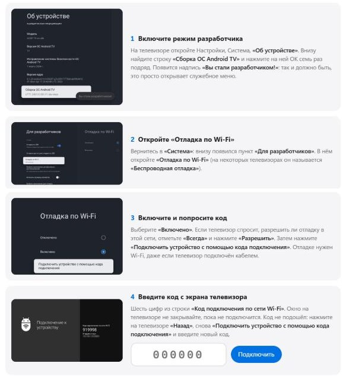

# HYDE TV

[ 🇷🇺 Русский ](README.md) | [ 🇬🇧 English ](README.en.md)

**A home screen for Google TV and Android TV sets instead of the stock one with ads.** Photos for the time of day, clock, weather and your apps. Installed from a computer in a few minutes and undone with one button.

- **No ads, nothing extra.** Your own home screen instead of the Google TV storefront.
- **All apps in one grid.** Reorder, pin and hide right from the remote.
- **Night mode.** Brightness and sleep timer over the film, the film keeps playing.
- **No flashing, no root.** Every change is logged, and "Restore" (Вернуть как было) brings the TV back the way it was.
- **Free, open source.** The TV apps are in Russian.

**Works with:** TVs and boxes on Google TV or Android TV with Android 9 and newer (TCL, Sony, Philips, Hisense, Xiaomi, Chromecast with Google TV).  
**Does not work with:** Samsung and LG, they run their own systems.

## How to install

You need a computer (Windows, Mac or Linux) on the same Wi-Fi as the TV, and the remote.

### 1. Download the archive

Open the **[release page](https://github.com/artemhyde/artemhyde_TV/releases/latest)** and under **Assets** click the file for your computer:

| Your computer | File to download |
|---|---|
| Windows | **HYDE-TV-1.1.0-Windows.zip** |
| Mac with Apple silicon (M1 and newer) | **HYDE-TV-1.1.0-macOS-Apple.zip** |
| Mac with Intel | **HYDE-TV-1.1.0-macOS-Intel.zip** |
| Linux | **HYDE-TV-1.1.0-Linux-x64.tar.gz** |

### 2. Unpack it

Windows: right click the archive, "Extract All". Mac: double click the archive.

### 3. Run the installer

#### Option 1. With Claude Code

Open Claude Code in the unpacked folder and type **"let's start"**. Claude walks you through it in your language and runs the installer itself.

#### Option 2. On your own

In the unpacked folder run **hyde-install** (`hyde-install.exe` on Windows, double click `hyde-install` on a Mac). The wizard opens in your browser and leads the way: what to switch on on the TV, which TV it is, what to install, and the Install button. The wizard is in Russian; the pictures show every step.

If Windows says "Windows protected your PC", click "More info", then "Run anyway". If a Mac refuses to open it: System Settings, Privacy & Security, "Open Anyway" at the bottom.

This is how the wizard shows what to do on the TV:

A TV on Android 9, 10 or 11 has no pairing code. The wizard shows a short path instead: turn on "USB debugging" and type the TV's address, no cable needed.

Don't like it: the same window has the **Restore** button (Вернуть как было). Later versions are installed by Guard on the TV itself; you need the computer again only if it asks.

---

More: [what's inside and how it works](docs/details.en.md) · [if something goes wrong](docs/troubleshooting.md) · [restore by hand](docs/rollback.md) · [build from source](CLAUDE.md) · [licenses](THIRD-PARTY.md)

Author: [@artemhyde](https://github.com/artemhyde). MIT license.
