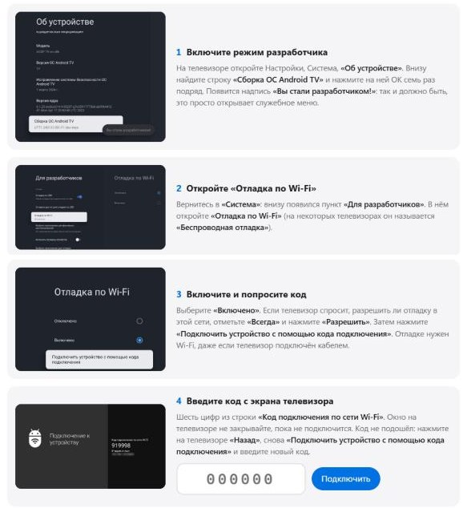

# HYDE TV

[ 🇷🇺 Русский ](README.md) | [ 🇬🇧 English ](README.en.md)

**Главный экран для телевизора на Google TV вместо заводского с рекламой.** Фото по времени суток, часы, погода и ваши приложения. Ставится с компьютера за несколько минут и возвращается обратно одной кнопкой.

- **Без рекламы и лишнего.** Свой главный экран вместо витрины Google TV.
- **Все приложения в одной сетке.** Порядок, закрепление и скрытие прямо с пульта.
- **«Ночной режим».** Яркость и таймер сна поверх фильма, фильм не останавливается.
- **Без перепрошивки и root.** Каждое изменение записывается, кнопка «Вернуть как было» возвращает телевизор к прежнему виду.
- **Бесплатно, код открыт.**

**Подойдёт:** телевизоры и приставки на Google TV или Android TV 12 и новее (TCL, Sony, Philips, Hisense, Xiaomi, Chromecast с Google TV).  
**Не подойдёт:** Samsung и LG, у них своя система.

## Как установить

Понадобятся компьютер (Windows, Mac или Linux) в одной сети Wi-Fi с телевизором и пульт.

### 1. Скачайте архив

Откройте **[страницу выпуска](https://github.com/artemhyde/artemhyde_TV/releases/latest)**, внизу в разделе **Assets** нажмите на файл для своего компьютера:

| Ваш компьютер | Какой файл скачать |
|---|---|
| Windows | **HYDE-TV-1.0.1-Windows.zip** |
| Mac на процессоре Apple (M1 и новее) | **HYDE-TV-1.0.1-macOS-Apple.zip** |
| Mac на процессоре Intel | **HYDE-TV-1.0.1-macOS-Intel.zip** |
| Linux | **HYDE-TV-1.0.1-Linux-x64.tar.gz** |

### 2. Распакуйте

Windows: правой кнопкой по архиву, «Извлечь всё». Mac: двойной щелчок по архиву.

### 3. Запустите установку

#### Способ 1. С Claude Code

Откройте Claude Code в распакованной папке и напишите **«давай начнём»**. Claude проведёт по шагам на вашем языке и сам запустит установщик.

#### Способ 2. Сами, без Claude

В распакованной папке запустите **hyde-install** (в Windows `hyde-install.exe`, на Mac двойной щелчок по `hyde-install`). В браузере откроется окно мастера, дальше он ведёт сам: что включить на телевизоре, какой это телевизор, что поставить, и кнопка «Установить».

Если Windows покажет «Система Windows защитила ваш компьютер», нажмите «Подробнее», затем «Выполнить в любом случае». Если Mac не даст открыть: «Системные настройки», «Конфиденциальность и безопасность», внизу «Всё равно открыть».

Что нужно сделать на телевизоре, мастер показывает так:

Не понравится: в том же окне кнопка **«Вернуть как было»**. Новые версии потом ставит сам «Сторож» на телевизоре, компьютер нужен, только если он попросит.

---

Подробнее: [что внутри и как устроено](docs/details.md) · [если что-то не так](docs/troubleshooting.md) · [вернуть вручную](docs/rollback.md) · [собрать из исходников](CLAUDE.md) · [лицензии](THIRD-PARTY.md)

Автор: [@artemhyde](https://github.com/artemhyde). Лицензия MIT.
