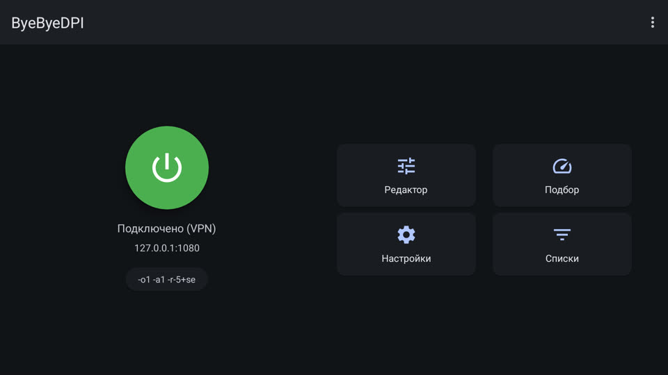
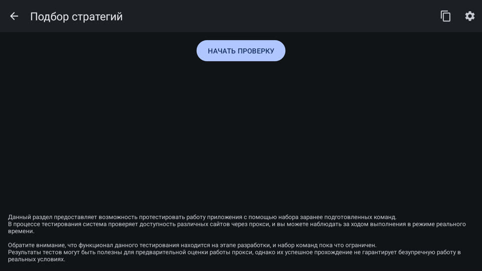

# ByeByeDPI: YouTube при замедлении у провайдера (необязательный модуль)

**Что это**  
ByeByeDPI это приложение для Android от автора romanvht, лицензия GPL-3.0 ([страница проекта](https://github.com/romanvht/ByeByeDPI)). Оно работает прямо на ТВ и меняет то, как отправляются первые пакеты соединения, чтобы оборудование провайдера, которое замедляет отдельные сервисы, их не узнавало. Своего сервера у него нет: трафик никуда не пересылается, не шифруется, IP-адрес остаётся вашим. Для Android он выглядит как VPN, потому что без root перехватить трафик на ТВ можно только так.  
Модуль нужен там, где провайдер замедляет YouTube. Где не замедляет, он ничего не даёт.

**Чего он не обещает**  
Работает не у всех провайдеров и не всегда: способы замедления меняются, и рабочие настройки меняются вслед за ними. С середины октября 2026 у части провайдеров видео YouTube через такие средства не загружается совсем. Заранее это не проверить, только на вашем интернете.  
В режиме «белых списков» на мобильном интернете (открыты только разрешённые сервисы) он не поможет.

**Что делает установщик (от вас ничего не нужно)**  
В окне установщика галочка «ByeByeDPI», по умолчанию выключена. Отмечаете её, и установщик сам:
1. Скачивает ByeByeDPI с [релизов автора](https://github.com/romanvht/ByeByeDPI/releases) (3,2 МБ) и сверяет подпись с отпечатком, который автор публикует сам. Не совпала: не ставит.
2. Разрешает ему режим VPN и уведомления без окон на экране и не даёт Android его усыплять.
3. Кладёт на ТВ список приложений, сам загружает его в ByeByeDPI, включает его и проверяет, что он поднялся. Около 40 секунд экран ТВ занят: пульт не трогайте. После перезагрузки ТВ ByeByeDPI включается сам.
4. Поручает его присмотру «Сторожа» (ниже).

Если ByeByeDPI у вас уже стоял до HYDE, его настройки установщик не трогает: список не загружает и ничего не переключает.  
Если загрузить список не вышло, установщик скажет об этом и ByeByeDPI не включит: без списка через него пошли бы все приложения. Тогда в ByeByeDPI откройте «Настройки»: «Фильтр приложений» поставьте «Белый список», в выборе приложений отметьте приложения ниже, включите автозапуск, а потом нажмите большую кнопку на главном экране.

Через ByeByeDPI идут только YouTube для ТВ, YouTube Kids, YouTube Music, SmartTube и «Волна» с её плеером. Всё остальное работает напрямую, как раньше: кинотеатры, банки, браузер, «Сторож».

**Так выглядит, когда работает**  
  
Открыть его можно из «Всех приложений». Большая кнопка включает и выключает.

**Присмотр «Сторожа»**  
Сам ByeByeDPI включается после перезагрузки ТВ, а после обновления или сбоя нет. Поэтому за ним смотрит «Сторож». Пока экран горит, он проверяет туннель и, если тот пропал не по вашей воле, включает его без окон на экране. Пока идёт видео, ждёт его конца.  
Выключили ByeByeDPI сами большой кнопкой: «Сторож» его не трогает до перезагрузки ТВ. Включили другой VPN или остановили ByeByeDPI в настройках Android: тоже не трогает.  
Что сейчас с ним, видно на экране «Сторожа», строка «ByeByeDPI (YouTube)». Если ByeByeDPI не поднимается или падает снова и снова, «Сторож» перестаёт его включать до перезагрузки ТВ и пишет там «не включается»: откройте ByeByeDPI и нажмите большую кнопку.  
Новые версии ByeByeDPI «Сторож» ставит сам, когда ничего не играет, и сразу включает туннель обратно. Настройки и подобранная вами стратегия сохраняются.

**Если YouTube всё равно тормозит**  
1. В ByeByeDPI плитка «Подбор», затем «Начать проверку». Он сам переберёт готовые настройки, покажет, какие у вашего провайдера работают, и лучшую можно выбрать сразу.  

2. Сайты в YouTube не открываются совсем: «Настройки», «DNS», выберите другой пункт списка (на одном TCL помог «Системный»).
3. Не помогло: у вашего провайдера сейчас этот способ не работает, остаётся свой VPN (ниже).

**Российские кинотеатры**  
Кинопоиск, Okko, Wink, Иви и другие приложения через ByeByeDPI не идут, адрес для них прежний. Но часть российских сервисов с весны 2026 проверяет, включён ли на устройстве VPN, и может попросить его выключить. Если так случится: выключите ByeByeDPI большой кнопкой и смотрите («Сторож» сам его не включит), потом включите обратно. И напишите нам в Issues: научим «Сторожа» делать это самому.

**Свой VPN вместо ByeByeDPI**  
Android держит включённым только один VPN. Если у вас уже есть свой ключ (от своего сервера или от того, кому вы доверяете), он надёжнее: замедление его не касается. HYDE не даёт серверов, ключей и подписок и не советует сервисы.  
Как подключить на ТВ: клиент с открытым кодом и версией для Android TV, например AmneziaVPN ([инструкция для Android TV](https://docs.amnezia.org/documentation/instructions/android_tv_connect/)). Ключ удобно перенести с телефона приложением «Вставка» из HYDE. В клиенте включите раздельное туннелирование по приложениям ([как это сделать](https://docs.amnezia.org/documentation/instructions/vpn-split-tunneling/)) и отметьте те же приложения: YouTube, SmartTube, «Волна» и её плеер «Aura (Волна)». Остальное оставьте напрямую.  
Перед этим выключите ByeByeDPI или уберите модуль.

**Куда он ходит в сеть**  
Сам ByeByeDPI ничего не шлёт на свои серверы. Запросы имён для выбранных приложений идут на DNS из его настроек (по умолчанию Cloudflare 1.1.1.1). «Подбор» при проверке открывает сайты из своих списков.

**Как убрать**  
Откат установщиком убирает модуль вместе с остальным: ByeByeDPI, его разрешение на VPN, исключение из сна, файл списка. Настройки внутри ByeByeDPI уходят вместе с приложением, присмотр «Сторож» снимает сам, когда ByeByeDPI удалён.  
Вручную: Настройки ТВ, Приложения, ByeByeDPI, Удалить.

**Для мастера и разработчика**  
Пакет `io.github.romanvht.byedpi`, проверенная версия 1.8.2 (файл universal), отпечаток сертификата в data/third-party-sources.json. В установщике это модуль `byedpi` (`hyde-install plan --with byedpi`), шаги в installer/recipe.json.  
Список приложений: файл `/sdcard/0 HYDE TV/ByeByeDPI-HYDE.json` в формате экспорта ByeByeDPI (`app`, `apps`, `settings`: режим VPN, фильтр приложений «белый список», автозапуск). Загружает его и включает туннель сценарий tools/byedpi-import.sh: в 1.8.2 меню «⋮» пультом не достать, поэтому оно открывается кнопкой MENU, «Импорт» берётся вторым пунктом по номеру (язык не важен), файл и «ОК» нажимаются только после проверки экрана. На время импорта ByeByeDPI получает доступ к файлам и сразу его теряет. Туннель включается только после удачного импорта.  
Обновления: ставится проверенная 1.8.2 от имени «Сторожа» (`adb install -i app.glasstv.guard`), новые версии он потом ставит сам без окна: строка в `apps/guard/assets/updates.txt`, тот же файл universal (со стоящим он сходится по сумме, лишнего скачивания нет). Ставит, только когда ничего не играет, и сразу включает туннель: сам ByeByeDPI после обновления не поднимается.  
Присмотр «Сторожа» (`apps/guard`, Bye.java и правила в ByeRules.java с тестом на ПК): включает его последняя строка сценария загрузки, и только если загрузка удалась (`am broadcast -n app.glasstv.guard/.Cmd --es do vpn --es a on`); `--es a off` выключает, `check` проверяет сразу, без `a` только состояние. Пока экран горит, «Сторож» раз в 5 секунд смотрит, есть ли VPN, после пробуждения и смены сети проверяет сразу; чей это VPN, берёт из `dumpsys connectivity` (поле OwnerUid). Кто выключил, видно по событиям окон (право GET_USAGE_STATS даёт модуль «Сторожа»): окно ByeByeDPI было на экране после того, как туннель видели в последний раз, значит человек. Без этого права окна приложению не видны совсем, и тогда пропажу туннеля «Сторож» считает решением человека. Не поднялся: повтор через минуту и через 5 минут, после третьей неудачи или трёх запусков за 10 минут «Сторож» перестаёт до перезагрузки ТВ. Состояние видно на экране «Сторожа», в отчёте (`do report`) и в его журнале.  
ByeByeDPI ставили выпуском 1.0.0: тогда установщик ставил его не от имени «Сторожа» и присмотр не включал. Включить присмотр: команда `do vpn --es a on` выше. Новые версии «Сторож» в этом случае предлагает окном «Обновить» на главном экране.  
Включить без окна: `am start -n io.github.romanvht.byedpi/.activities.ToggleActivity --ez only_start true` (`only_stop` выключает). Работает ли: `dumpsys connectivity | grep 'VPN CONNECTED'`, кто внутри: строка `Uids` той же сети.  
Разрешения ставятся вместе с `appops write-settings`: без неё Android записывает их на диск с задержкой до 30 минут, и внезапная перезагрузка их стирает (так было на виртуальном ТВ).  
Проверено 07.11.2026 на виртуальном Google TV (Android 14): установка со сверкой подписи, загрузка списка и включение без нажатий (весь модуль за 35 секунд, два прогона с нуля), в туннеле только YouTube и YouTube Music, присмотр «Сторожа» за DNS туннелю не мешает, автозапуск после перезагрузки, откат без следов. Присмотр и обновления проверены там же 07.11.2026: сбой процесса туннеля (поднят за 3 секунды, окно на экране не мелькнуло), выключение в окне ByeByeDPI и сразу «Домой» (не включает до перезагрузки, в том числе сразу после своего обновления), включение руками, остановка в настройках, сон, тихое обновление (скачано с GitHub, поставлено без окна, туннель снова через 5 секунд, повторная проверка ничего не качает), перезагрузка (решение человека забыто).  
Не проверено: работа против замедления (нужен человек в России), сам YouTube (на этом виртуальном ТВ он не запускается), TCL, смена сети (у виртуального ТВ Ethernet, режим полёта его не трогает), чужой VPN рядом (правило проверено тестом на ПК).
