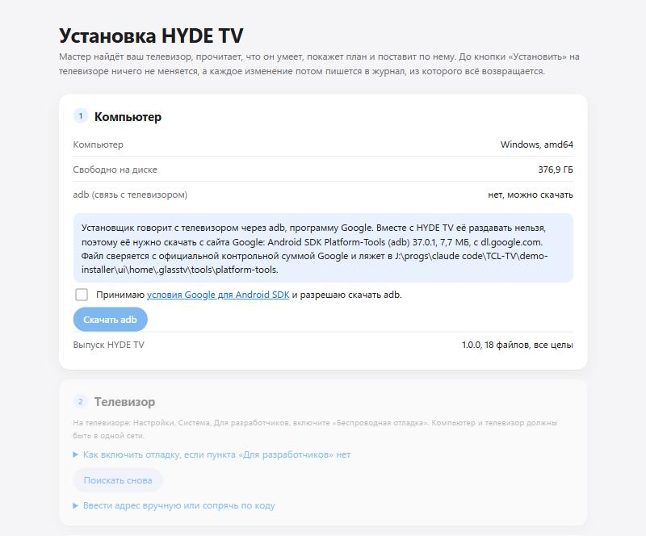
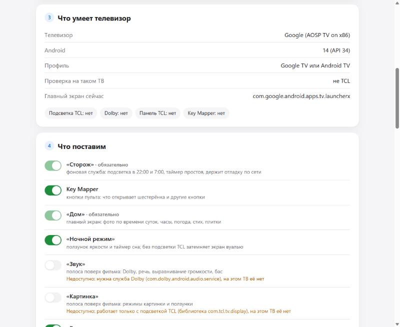
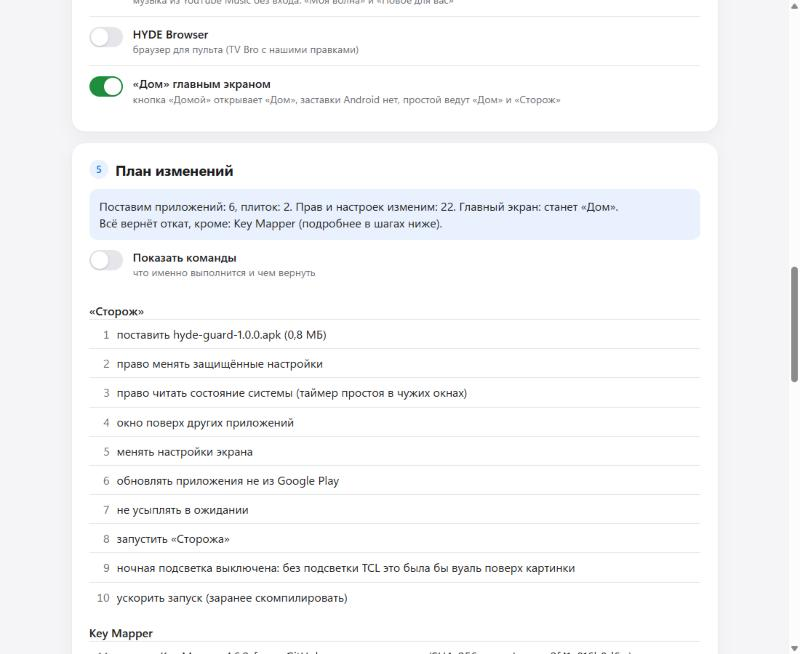

# Установка окном мастера

Главный путь: архив выпуска и окно мастера в браузере, без Claude и без инструментов сборки. Написано для Windows; на macOS и Linux то же окно, отличается только запуск (README.txt в архиве). Снимки сделаны на виртуальном Google TV, выпуск 1.0.0.

**Перед началом**  
Телевизор на Google TV или Android TV 12 и новее ([compatibility.md](../compatibility.md)), компьютер в той же домашней сети, пульт под рукой.

**1. Скачать и запустить**  
На странице Releases скачайте `HYDE-TV-<версия>-Windows.zip`, правой кнопкой «Извлечь всё», в распакованной папке запустите `hyde-install.exe`. Windows может сказать «Система Windows защитила ваш компьютер»: программа не подписана платным сертификатом, нажмите «Подробнее» и «Выполнить в любом случае». Откроются чёрное окно (его не закрывайте, пока идёт работа) и окно мастера в браузере. Без действий 30 минут установщик закрывается сам.

**2. Компьютер**  
Мастер показывает систему, свободное место и есть ли adb, программа Google для связи с телевизором. Её нет: поставьте галочку «Принимаю условия Google для Android SDK и разрешаю скачать adb» (условия открываются по ссылке) и нажмите «Скачать adb». Около 8 МБ с dl.google.com, файл сверяется с официальной контрольной суммой Google. Ниже строка «Выпуск HYDE TV»: все файлы целы.  

**3. Телевизор**  
На телевизоре включите «Беспроводную отладку»: Настройки, Система, Для разработчиков. Пункта «Для разработчиков» нет: раскройте в мастере «Как включить отладку» (семь нажатий OK на «Сборка ОС Android TV»). Мастер сам ищет телевизоры в сети: у найденного нажмите «Подключить», у уже подключённого «Выбрать».  
Первый раз телевизор не знает компьютер: раскройте «Ввести адрес вручную или сопрячь по коду», на телевизоре в «Беспроводная отладка» нажмите «Подключить устройство с помощью кода» и введите в мастер адрес, порт и шесть цифр из этого окна, «Сопрячь». Потом «Подключить». Телевизор спросит «Разрешить отладку?»: «Разрешить».  

**4. Что умеет телевизор**  
Мастер читает паспорт телевизора (модель, Android, подсветка TCL, Dolby, панель TCL, Key Mapper, кто сейчас главный экран) и говорит, подходит ли он. На телевизоре уже стоит HYDE с этого компьютера: здесь же кнопки «Проверить телевизор» и «Откатить всё».  

**5. Что поставим и план**  
Переключатели модулей: «Сторож» и «Дом» обязательны, недоступное на этом телевизоре выключено с причиной. Отдельно «Дом главным экраном»: по умолчанию главный экран остаётся прежним, «Дом» открывается из списка приложений. Ниже план: сколько приложений поставит, какие права и настройки изменит и что откат не вернёт. «Показать команды» раскрывает, что именно выполнится и чем вернётся.  

**6. Установка**  
Согласия, если они нужны по плану: скачать Key Mapper с GitHub; «Телевизор свободен» (при смене главного экрана мастер открывает «Дом» и нажимает «Домой»). Затем «Установить по плану»: по шагам видно, что сделано. Связь пропала посреди: подключитесь снова и нажмите ту же кнопку, установка продолжит с того же места.  
  

**7. После установки**  
Мастер пишет, что сделать на самом телевизоре: проверить «Домой» на пульте, выбрать город и цвет стекла в «Настройках «Дома»», назначить кнопку пульта в Key Mapper. Ниже «Сторож»: отладка по сети (держать всегда, чтобы потом обновлять и откатывать с этого компьютера, или выключить через 2 часа) и записки с телефона, обе с тем, что сейчас на телевизоре. «Проверить телевизор» показывает, держится ли каждое изменение; «Откатить всё» возвращает как было. На снимке виртуальный ТВ без Wi-Fi, поэтому отладка по сети там «выключена»; на настоящем телевизоре «Сторож» держит её включённой.  

**Где что осталось**  
adb: `C:\Users\<имя>\.glasstv\tools`, журналы и снимок телевизора «до»: `C:\Users\<имя>\.glasstv\backup` (в нём идентификатор телевизора, никуда его не отправляйте). Папку архива после установки можно удалить: следующий выпуск найдёт журналы сам.  
Что-то пошло не так: [troubleshooting.md](../troubleshooting.md). Вернуть как было: [rollback.md](../rollback.md).
