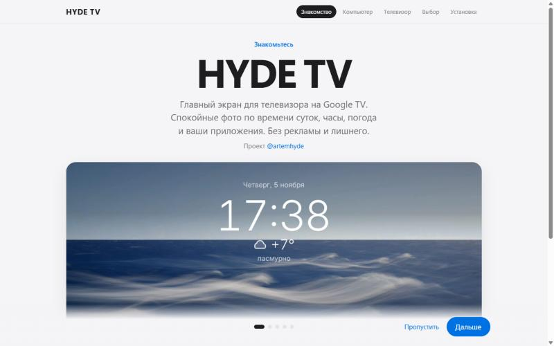
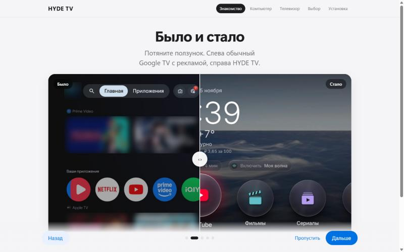
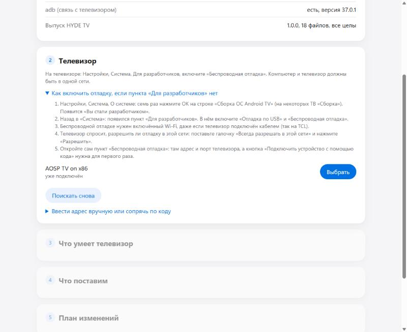
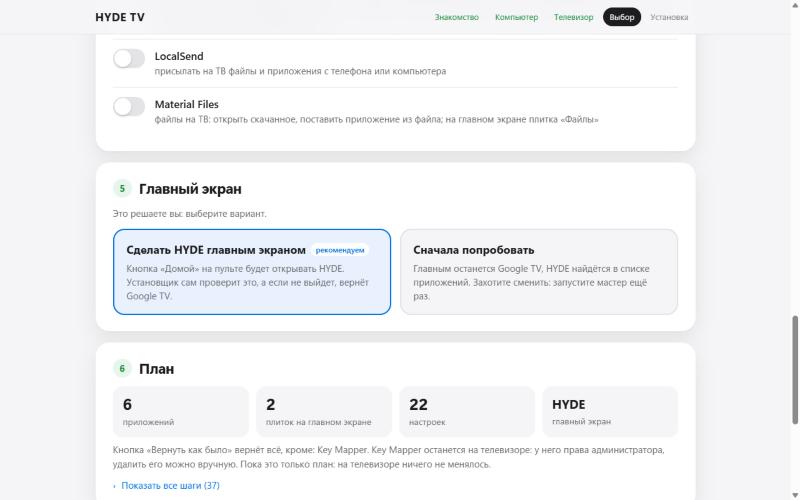
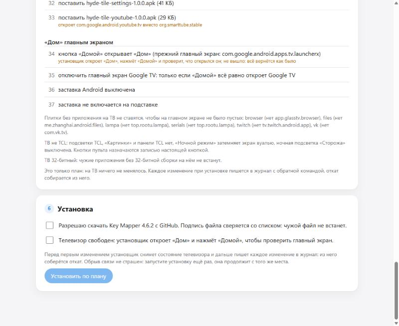
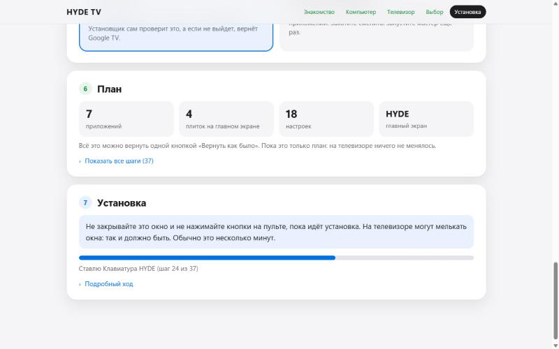
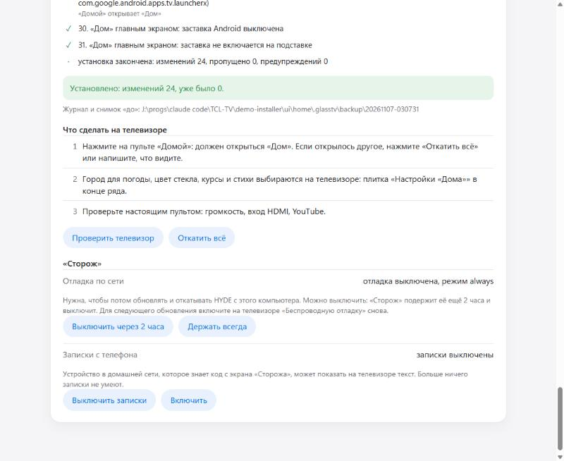

# Установка окном мастера

Главный путь: архив выпуска и окно мастера в браузере, без Claude и без инструментов сборки. Написано для Windows; на macOS и Linux то же окно, отличается только запуск (README.txt в архиве). Снимки окна сделаны на виртуальном Google TV, снимки экранов телевизора с настоящего TCL 65C6K и виртуального Google TV, выпуск 1.0.0.

**Перед началом**  
Телевизор на Google TV или Android TV 12 и новее либо приставка с Google TV ([compatibility.md](../compatibility.md)). Samsung и LG не подойдут: у них своя система. Компьютер в той же домашней сети Wi-Fi, пульт под рукой, телевизором в это время никто не пользуется.

**1. Скачать и запустить**  
На странице Releases скачайте `HYDE-TV-<версия>-Windows.zip`, правой кнопкой «Извлечь всё», в распакованной папке запустите `hyde-install.exe`. Windows может сказать «Система Windows защитила ваш компьютер»: программа не подписана платным сертификатом, нажмите «Подробнее» и «Выполнить в любом случае». Откроются чёрное окно (его не закрывайте, пока идёт работа) и окно мастера в браузере. Без действий 30 минут установщик закрывается сам.

**2. Вступление**  
Пять кадров: что такое HYDE TV, «Было и стало» (ползунок между обычным Google TV и HYDE), что внутри, подойдёт ли телевизор и что понадобится. Листать кнопкой «Дальше» или стрелками на клавиатуре, «Пропустить» сразу ведёт к шагам.  
  

**3. Компьютер**  
Мастер проверяет, есть ли adb, программа Google для связи с телевизором, и целы ли файлы выпуска. adb нет: поставьте галочку «Принимаю условия Google для Android SDK и разрешаю скачать adb» (условия открываются по ссылке) и нажмите «Скачать adb». Около 8 МБ с dl.google.com, файл сверяется с официальной контрольной суммой Google.

**4. Подключите телевизор**  
Мастер сам ищет телевизоры в сети каждые несколько секунд, нажимать «Искать» не нужно. Телевизор, с которым этот компьютер уже сопрягался, появится сам: нажмите «Это мой телевизор». Первый раз сделайте на телевизоре четыре шага, они же показаны в окне со снимками экрана:
1. Настройки, Система, «Об устройстве». На строке «Сборка ОС Android TV» нажмите OK семь раз подряд, появится «Вы стали разработчиком!».
2. Назад в «Система»: появился пункт «Для разработчиков». В нём откройте «Отладка по Wi-Fi» (на некоторых телевизорах «Беспроводная отладка»).
3. Выберите «Включено». Телевизор спросит, разрешить ли отладку в этой сети: отметьте «Всегда» и нажмите «Разрешить». Затем «Подключить устройство с помощью кода подключения». Отладке нужен Wi-Fi, даже если телевизор подключён кабелем.
4. Введите в окне мастера шесть цифр из строки «Код подключения по сети Wi-Fi». Мастер сам найдёт это окно телевизора в сети, сопряжёт компьютер и подключится. Окно на телевизоре не закрывайте, пока не подключится.

Телевизор не нашёлся сам: раскройте «Ввести адрес вручную» (адрес из строки «IP-адрес и порт» на экране «Отладка по Wi-Fi»).  
Телевизор на Android 9, 10 или 11 (пункта «Отладка по Wi-Fi» нет): раскройте «Телевизор на Android 9, 10 или 11», включите на телевизоре «Отладка по USB», введите IP-адрес телевизора из настроек сети и ответьте на экране телевизора «Всегда разрешать с этого компьютера».  

**5. Ваш телевизор**  
Мастер читает паспорт телевизора и сразу пишет вывод: подходит ли он и что на нём будет работать (на TCL 65C6K всё, на TCL других серий функции TCL экспериментальные, на других марках без подсветки TCL и «Картинки»). Модель, Android, профиль и что есть на телевизоре раскрываются в «Подробнее о телевизоре». На телевизоре уже стоит HYDE с этого компьютера: здесь же кнопки «Проверить телевизор» и «Откатить всё».

**6. Что поставим**  
Переключатели: «Сторож» и «Дом» входят всегда, недоступное на этом телевизоре выключено с причиной. «Волна» помечена как экспериментальная. Ниже «Приложения по желанию»: SmartTube, Lampa, TorrServe, LocalSend и Material Files, по умолчанию выключены. Включённые качаются со страниц их авторов на GitHub закреплённой версией, ставятся, только если сумма файла и подпись совпали со списком, откат их удаляет, а новые версии потом ставит «Сторож».

**7. Главный экран**  
Выбор виден двумя карточками, заранее отмечена рекомендуемая. «Сделать HYDE главным экраном»: кнопка «Домой» на пульте будет открывать HYDE, установщик проверит это сам, а не выйдет, вернёт прежний экран. «Сначала попробовать»: главный экран останется прежним, HYDE откроется из списка приложений; сделать его главным можно потом, запустив установщик снова.  

**8. План и установка**  
План цифрами: сколько приложений и плиток поставит, сколько прав и настроек изменит, каким будет главный экран, что откат не вернёт. Все шаги по порядку и команды раскрываются по желанию. Затем согласия, если они нужны: скачать приложения со страниц авторов (с перечнем и размерами); «Телевизором сейчас никто не пользуется» (при смене главного экрана мастер открывает HYDE и нажимает «Домой»). «Установить»: полоса хода и текущий шаг, подробный ход раскрывается. Связь пропала посреди: подключитесь снова и нажмите ту же кнопку, установка продолжит с того же места.  
  

**9. После установки**  
Мастер пишет, что сделать на самом телевизоре: проверить «Домой» на пульте, выбрать город и цвет стекла в «Настройках «Дома»», назначить кнопку пульта в Key Mapper, настроить Lampa и TorrServe, если их ставили. В «Безопасность» отладка по сети (держать всегда, чтобы потом обновлять и откатывать с этого компьютера, или выключить через 2 часа) и записки с телефона, обе с тем, что сейчас на телевизоре. «Проверить телевизор» показывает, держится ли каждое изменение; «Откатить всё» спрашивает подтверждение прямо в окне и возвращает как было.  

**Где что осталось**  
adb: `C:\Users\<имя>\.glasstv\tools`, журналы и снимок телевизора «до»: `C:\Users\<имя>\.glasstv\backup` (в нём идентификатор телевизора, никуда его не отправляйте). Папку архива после установки можно удалить: следующий выпуск найдёт журналы сам.  
Что-то пошло не так: [troubleshooting.md](../troubleshooting.md). Вернуть как было: [rollback.md](../rollback.md).
