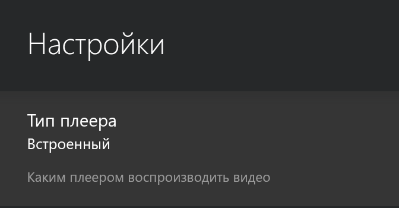
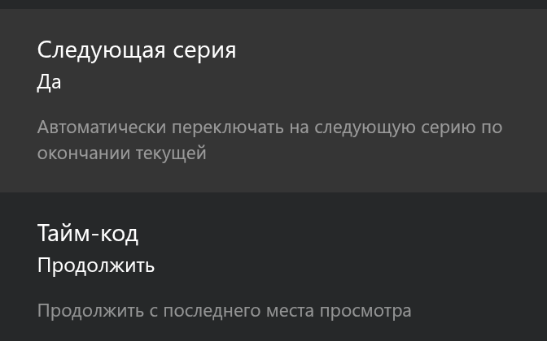
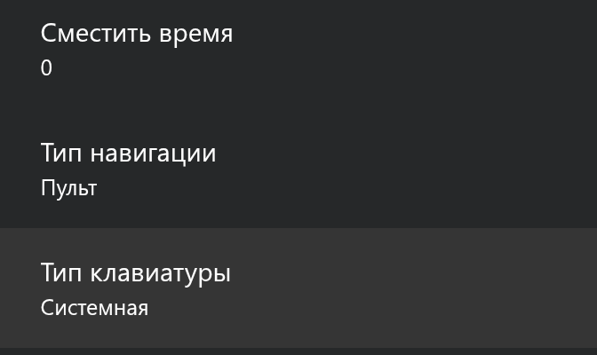
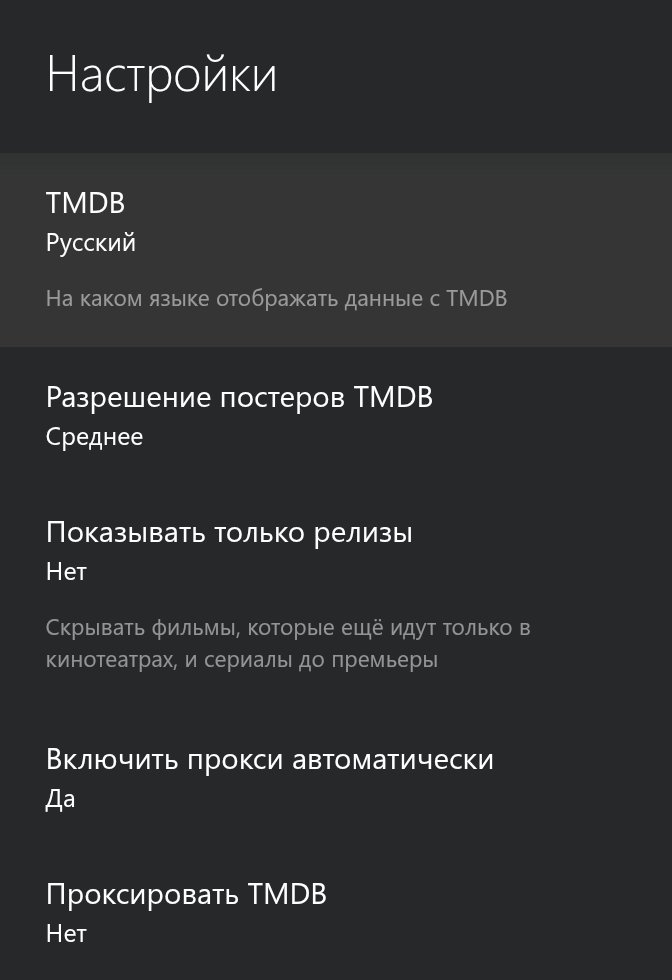
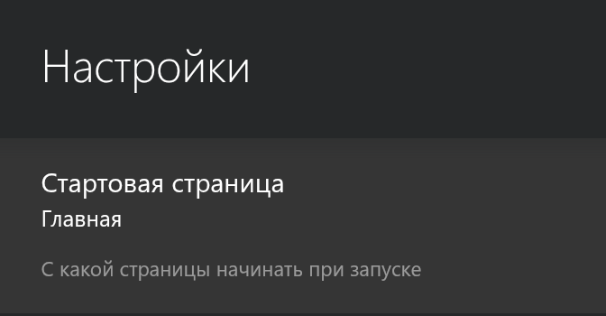

# Lampa: памятка настроек

Lampa это отдельный проект (ссылка и лицензия в [THIRD-PARTY.md](../THIRD-PARTY.md)). Мы не меняем её код, мы советуем несколько её собственных настроек, чтобы она удобно работала с пультом ТВ. Мастер показывает эту памятку, выставляете настройки вы сами, а он подсказывает, куда смотреть.

Расширения вы добавляете сами, мастер их не ищет и не вводит.

**Плеер**  
Настройки, Плеер, «Тип плеера»: «Встроенный». Видео идёт в самой Lampa, работают сезоны и автопереход.  

**Автопереход на следующую серию**  
Настройки, Плеер, «Следующая серия»: «Да». По окончании серии включается следующая.  

**Клавиатура**  
Настройки, Остальное, «Тип клавиатуры»: «Системная». С ней в поиск Lampa печатает клавиатура компьютера из окна зеркала экрана (tools/screen-mirror.sh), а текст из буфера вставляет tools/paste-to-tv.sh.  

**Язык каталога**  
Настройки, TMDB: язык «Русский». Название и описания придут по-русски.  

**Прокси TMDB**  
Настройки, TMDB, «Проксировать TMDB»: «Нет» по умолчанию (на снимке выше). Если каталог пустой, причина может быть в частном DNS: некоторые блокировщики рекламы отвечают на адрес api.themoviedb.org адресом 127.0.0.1, и обложки с описаниями не грузятся. Тогда включите «Проксировать TMDB» или смените DNS: Настройки ТВ, Сеть и интернет, Частный DNS, «Автоматически».

**Стартовая страница**  
Пункт «Стартовая страница» в настройках: «Главная». С какой страницы начинать при запуске.  

**Плитки «Фильмы» и «Сериалы»**  
Если вы выбрали Lampa при установке, мастер ставит две плитки: «Фильмы» открывает Lampa сразу в разделе фильмов, «Сериалы» в разделе сериалов (данные берутся из каталога TMDB).

**Какие снимки нужны для этой памятки**  
Экраны настроек Lampa, обрезанные до правой панели (от x равной 1248 пикселей), без каталога: на постерах и плашках каталога мы не показываем чужое. Имена файлов: lampa-player.png, lampa-next-episode.png, lampa-keyboard.png, lampa-tmdb.png, lampa-start-page.png, все в docs/screenshots/.
